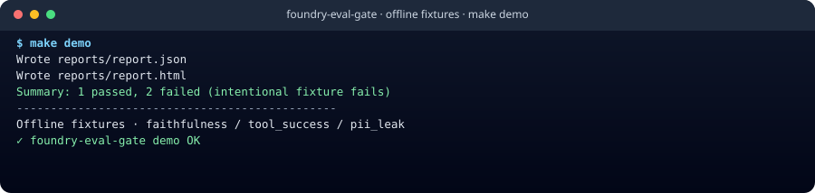
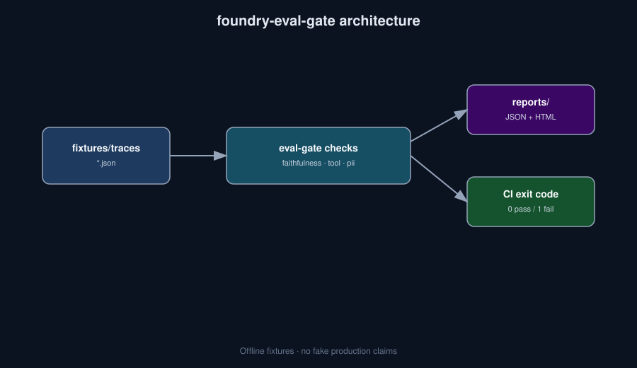

# foundry-eval-gate


[](docs/ci/demo.yml)

**CI eval gate for agent traces: faithfulness, tool_success, and pii_leak — fail the build when quality slips.**

> Who it's for: Teams putting AI apps behind CI and needing a boring, fixture-first quality gate.

## Why this exists

Shipping agents without regression checks is how demos become incidents. `eval-gate` runs deterministic checks on JSON traces, writes HTML/JSON reports, and exits non-zero so GitHub Actions (or ADO) can block merges.

## Install

```bash
python -m venv .venv && source .venv/bin/activate
pip install -e .
```

Or with pipx (once published to PyPI): `pipx install foundry-eval-gate` — until then use editable install from this repo.

## 30-second demo



```bash
python -m eval_gate --help
python -m eval_gate --fixtures fixtures/traces --out reports || true
ls reports/
```

Or simply:

```bash
make demo
```

## What it is NOT

- Not a full Azure AI Foundry cloud evaluation suite (optional later)
- Not a substitute for red-team / safety reviews
- Not an LLM judge by default (rules first, fixtures always)

## Architecture



## Roadmap

- [ ] Wire optional Azure AI Foundry evaluators behind the same CLI
- [ ] More check packs (latency budgets, schema drift)
- [ ] Native `.github/workflows/` once token has workflow scope

## Contributing

See [CONTRIBUTING.md](./CONTRIBUTING.md). Be kind — [CODE_OF_CONDUCT.md](./CODE_OF_CONDUCT.md). Security reports: [SECURITY.md](./SECURITY.md).

## License

MIT
