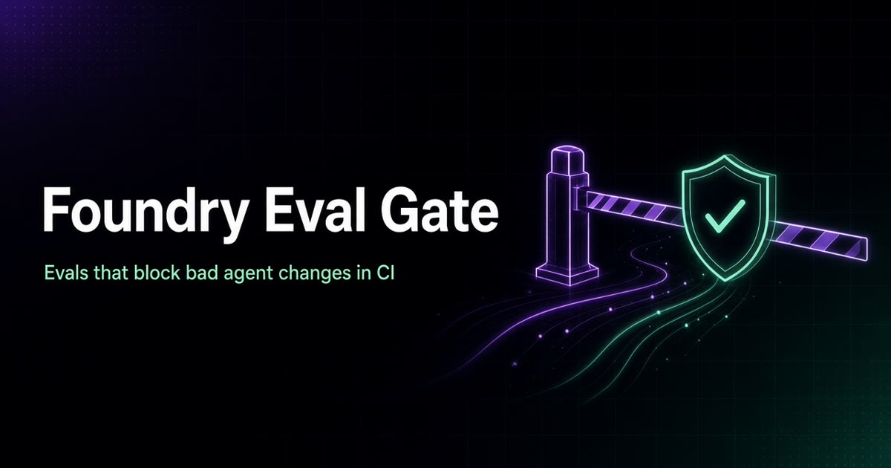
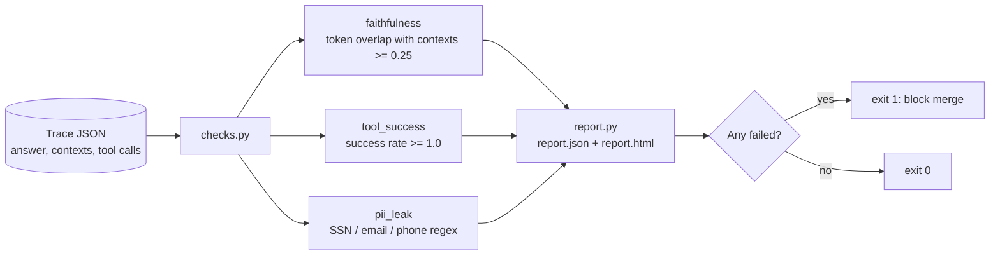

# foundry-eval-gate




[](docs/ci/demo.yml)

**CI eval gate for agent traces: faithfulness, tool_success, and pii_leak — fail the build when quality slips.**

> Who it's for: Teams putting AI apps behind CI and needing a boring, fixture-first quality gate.

## Why this exists

Shipping agents without regression checks is how demos become incidents. `eval-gate` runs deterministic checks on JSON traces, writes HTML/JSON reports, and exits non-zero so GitHub Actions (or ADO) can block merges.

## Install

```bash
python -m venv .venv && source .venv/bin/activate
pip install -e .
```

Or with pipx (once published to PyPI): `pipx install foundry-eval-gate` — until then use editable install from this repo.

## 30-second demo


```bash
python -m eval_gate --help
python -m eval_gate --fixtures fixtures/traces --out reports || true
ls reports/
```

Or simply:

```bash
make demo
```

## What it is NOT

- Not a full Azure AI Foundry cloud evaluation suite (optional later)
- Not a substitute for red-team / safety reviews
- Not an LLM judge by default (rules first, fixtures always)

## Design & Engineering

I designed this as the quality gate I want in front of every agent change: cheap, deterministic, and able to fail a build.

**Design goals**

- Check agent traces for the failures that hurt most in production: unfaithful answers, failing tools and leaked PII.
- Rules and fixtures first, so results are repeatable and run in seconds on any CI runner.
- Exit non-zero on failure, so GitHub Actions or Azure DevOps can block the merge.

**Architecture**




**Key design decisions and trade-offs**

| Decision | Why | Trade-off |
|---|---|---|
| No LLM judge by default | Deterministic, free and fast; the same trace always gets the same score | Token overlap is a rough proxy for faithfulness, not meaning |
| Regex PII patterns | Catches the obvious leaks instantly; traces can mark `pii_expected` when PII is legitimate | Misses PII that doesn't match a pattern |
| Tool success must be 100% | A failed tool call in a trace is a regression worth looking at | Strict for flaky external tools |
| Fixtures include intentional failures | Proves the gate actually fails builds | Demo output always shows red rows |

**Engineering details**

- **Stack:** Python 3.10+, `argparse` CLI (`python -m eval_gate --fixtures ... --out ...`), JSON and HTML reports.
- **Fixtures:** `fixtures/traces/` has a good trace, a bad-faithfulness trace and a bad-tool-plus-PII trace.
- **CI:** `make demo` checks both reports are written; workflow templates are in [`docs/ci/demo.yml`](docs/ci/demo.yml) and [`docs/examples/eval-gate.yml`](docs/examples/eval-gate.yml).

**What I'd do next**

- Optional Azure AI Foundry evaluators behind the same CLI and report format.
- More check packs: latency budgets and schema drift.
- Native `.github/workflows/` in this repo.

## Roadmap

- [ ] Wire optional Azure AI Foundry evaluators behind the same CLI
- [ ] More check packs (latency budgets, schema drift)
- [ ] Native `.github/workflows/` once token has workflow scope

## Contributing

See [CONTRIBUTING.md](./CONTRIBUTING.md). Be kind — [CODE_OF_CONDUCT.md](./CODE_OF_CONDUCT.md). Security reports: [SECURITY.md](./SECURITY.md).

## License

MIT
